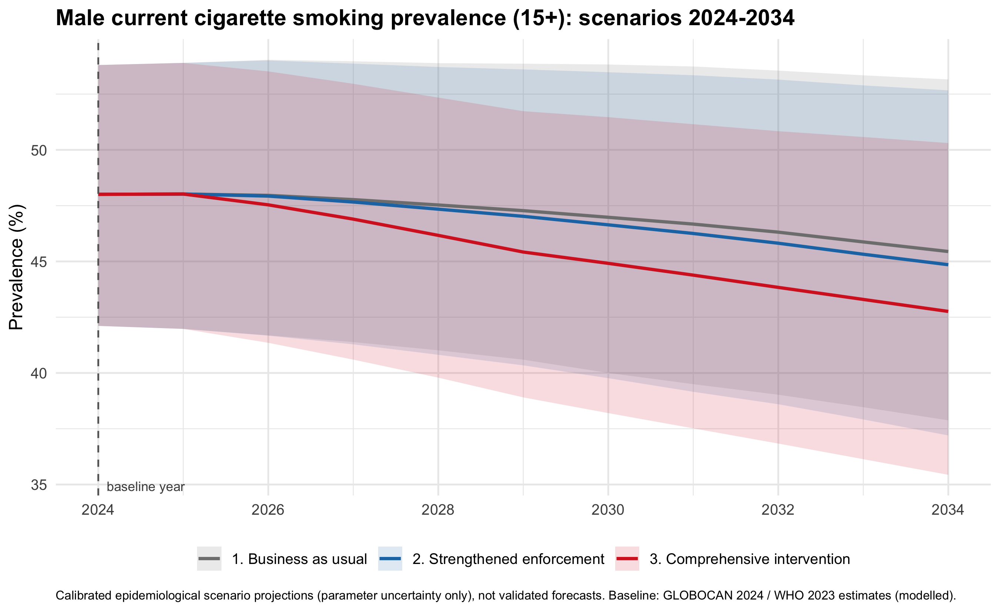
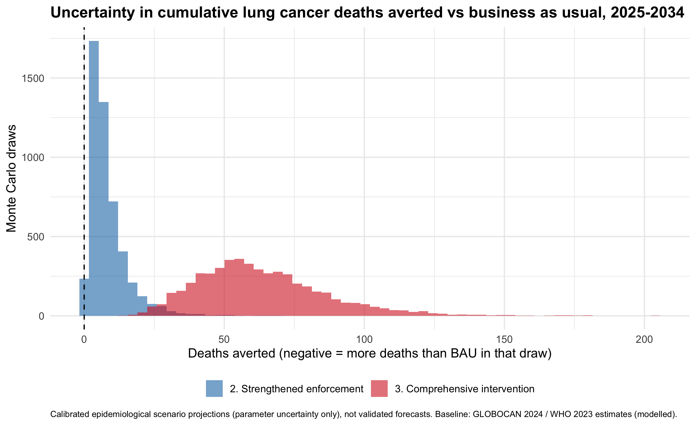

# Lung Cancer and Tobacco Control in Armenia: A 10-Year Predictive Model

*A scenario-based study of smoking, lung cancer, and tobacco-control enforcement in Armenia, 2024–2034.*

Supervisor: Dr. Selimyan · Team: Ani Hovhannisyan, Elina Davtyan, Nina Tevosyan, Yekaterina Ayvazyan

---

## Overview

Lung cancer is the second most frequently diagnosed cancer in Armenia, and the most frequent cause of cancer death. About 48% of Armenian men are estimated to smoke cigarettes, compared with about 1.4% of women. Armenia has adopted a tobacco-control law and is a party to the WHO Framework Convention on Tobacco Control (ratified 2004), but reported compliance with smoke-free rules is incomplete, and its effect on future lung cancer is hard to judge because the health benefits of reduced smoking appear only after years or decades.

This project examines the relationship between tobacco use, lung cancer, tobacco-control policy, and policy enforcement in Armenia. It combines epidemiological data, policy and economic analysis, a comparison with Georgia, two international case studies (Ireland and Australia), small descriptive surveys, and a computational model. The model explores how smoking prevalence, lung cancer incidence, and lung cancer mortality in Armenia could develop between 2024 and 2034 under three tobacco-control scenarios.

All results are **scenario-based estimates that depend on stated assumptions. They are not validated forecasts** (see [Limitations](#limitations) and [Disclaimer](#disclaimer)).

## Research Questions and Objectives

The project outline defines three objectives:

1. Examine the relationship between tobacco use and lung cancer, and assess the current situation in Armenia using scientific and government data.
2. Analyse tobacco-control policies and their enforcement in Armenia, and compare Armenia and Georgia using government data, lifestyle factors, independent research, and a survey.
3. Develop a 10-year predictive model for Armenia under different enforcement scenarios, and identify lessons from international case studies that could inform evidence-based recommendations.

The Armenia–Georgia comparison is intended to be balanced: it describes similarities and differences and does not rank one country above the other.

## Research Scope

| # | Area | What it covers |
|---|------|----------------|
| 1 | Scientific background | How tobacco exposure contributes to lung cancer: carcinogens, DNA damage, mutations, cancer development. |
| 2 | Armenia | Smoking prevalence, lung cancer incidence and mortality, tobacco-control legislation, enforcement, compliance, taxation, pricing, accessibility. |
| 3 | Armenia–Georgia comparison | Government sources, policies, enforcement information, tobacco use, lifestyle and economic indicators. |
| 4 | International case studies and surveys | Ireland and Australia (New South Wales); short surveys in Armenia and Georgia. |
| 5 | Data analysis and predictive modelling | Ten-year scenario model for Armenia, uncertainty analysis, and sensitivity analysis. |

This repository contains the data, curated policy tables, code, and results that support areas 2–5. Area 1 is literature-based and has no code or data component here. The model and its outputs (area 5) are the computational core of the repository.

## Data and Sources

The input files are in [`data/raw/`](data/raw/) and are described file by file in [`data/README.md`](data/README.md) and [`documentation/data_sources.md`](documentation/data_sources.md). In summary:

- **Lung cancer burden:** GLOBOCAN 2024 estimates for Armenia (IARC/WHO): incidence, mortality, and population by sex, and cases by cancer site. GLOBOCAN figures for Armenia are *modelled* estimates.
- **Tobacco use:** WHO age-standardised modelled estimates (2023), SDG indicator 3.a.1 survey series, and national surveys (STEPS, HSPA, HBSC).
- **Policy and enforcement:** WHO MPOWER indicators from the WHO Global Tobacco Report (2024 data for Armenia, Georgia, and Ireland; 2022 data for Australia), plus a team-compiled comparison table of legal provisions, enforcement infrastructure, and reported compliance, in which each row carries its own verification status ([`data/curated/policy_comparison.csv`](data/curated/policy_comparison.csv)).
- **Prices, taxes, and revenue:** retail prices, tax shares, and tobacco tax revenue.
- **Primary survey data:** a short Armenian survey (n = 65) and a Georgian survey (n = 72). Timestamps were reduced to dates and the files contain no names or contact details.

Parameters without Armenian data (for example the annual quit rate and all policy effect sizes) are **assumptions**, not observations. They are listed with their supporting literature, or the lack of it, in [`documentation/assumptions.md`](documentation/assumptions.md).

## Methodology

- **Epidemiological and statistical analysis.** Historical tobacco-use series are used only to estimate a relative business-as-usual trend (log-linear regression, shrunk by 50% toward zero). Different survey definitions are not merged.
- **Policy and economic analysis.** Legal provisions, enforcement infrastructure, and reported compliance are kept separate. Transparent descriptive scores are computed from WHO-reported indicators; they are not effect sizes.
- **Computational model.** A sex-specific compartmental smoking model (never, current by duration, former by time since quitting) feeds an exposure-history lung cancer model. Mortality is modelled separately as a lagged fraction of incident cases, calibrated to 2024 GLOBOCAN deaths.
- **Uncertainty.** Monte Carlo simulation (5,000 draws) over 33 uncertain parameters plus Dirichlet-distributed exposure and survival-lag profiles.
- **Sensitivity.** Global Spearman rank correlations and a one-at-a-time tornado analysis.

The full description with equations is in [`documentation/methodology.md`](documentation/methodology.md).

## Predictive Model

The model covers adults aged 15 and over, by sex, for 2024–2034. Policies begin to take effect in 2026 and phase in over three to four years.

| Scenario | Description |
|----------|-------------|
| **1. Continuation of current trends** (business as usual) | Baseline hazards stay constant; no policy change. |
| **2. Stricter enforcement** | Reported smoke-free compliance rises from 8/10 toward 9.5/10. Only a share of the planned improvement is delivered (mean 0.6), which represents the implementation gap. Enforcement raises quitting and lowers initiation. |
| **3. Comprehensive tobacco-control package** | Scenario 2 plus cessation support, mass-media campaigns, stronger advertising restrictions and warnings, and a tax increase from 48.9% to 60% of the retail price. Non-price measures are combined multiplicatively with an overlap discount to limit double counting. |

**Simulation runs.** The model was run 5,000 times (seed `20241125`). In each run, all uncertain parameters are drawn once and the *same* draw is applied to all three scenarios (common random numbers), so differences between scenarios are not blurred by independent noise. The simulation rejects draws that imply a lung cancer case-fatality fraction above 0.98; 2,069 draws were rejected in the published run ([`simulation_diagnostics.csv`](results/simulations/simulation_diagnostics.csv)).

**Uncertainty ranges.** Intervals reported here are the 2.5th and 97.5th percentiles across the 5,000 draws. They represent *parameter* uncertainty only. Scenario uncertainty is shown by the three explicit scenarios, and *structural* uncertainty (for example, omitted relapse and the absence of age structure) is not sampled.

**Sensitivity analysis.** Spearman rank correlations across all draws identify which parameters drive the results; a tornado analysis moves each parameter to its 2.5th and 97.5th sampled percentile while holding the others at central values. For the comprehensive package, the most influential parameters are the price elasticity of demand (rank correlation 0.53 with cumulative deaths averted), the half-life of the decline in lung cancer risk after quitting (−0.48), and the share of the price response that works through smoking participation (0.34). For enforcement alone, the effect of compliance on quit rates (`bsf`) dominates (0.76). All of these are assumptions rather than Armenian estimates. See [`results/sensitivity/`](results/sensitivity/).

## Key Findings

Values are medians of the 5,000 simulation runs, with 95% uncertainty intervals in parentheses. The 2024 values are the *modelled* baseline, which is calibrated to, but not identical with, the GLOBOCAN inputs (1,513 lung cancer cases and 1,270 deaths in 2024; WHO male cigarette prevalence of 47.9%).

| Quantity | Result |
|----------|--------|
| Lung cancer diagnoses in Armenia, 2024 | **1,603** (1,306–2,090) |
| Lung cancer deaths in Armenia, 2024 | **1,251** (1,098–1,426) |
| Male current cigarette smoking prevalence, 2024 | **about 48%** (42.1–53.8%) |
| Male prevalence in 2034: continuation / stricter enforcement / full package | 45.4% / 44.9% / 42.8% |
| Difference in male prevalence in 2034, continuation vs full package | **2.7 percentage points** |
| Lung cancer deaths averted 2025–2034, full package vs continuation | **about 60** (28–118) |
| Lung cancer deaths averted 2025–2034, stricter enforcement vs continuation | **about 6** (1–27) |

The 2024 modelled diagnoses (1,603) are above the GLOBOCAN input (1,513). The model places a 15% multiplicative uncertainty on GLOBOCAN incidence because it is a modelled estimate, and it rejects draws that would imply a case-fatality fraction above 0.98. Together these shift the median upward. The modelled deaths (1,251) are close to the GLOBOCAN input.

Additional results, from [`averted_vs_bau.csv`](results/simulations/averted_vs_bau.csv):

| | Stricter enforcement | Full package |
|---|---|---|
| Cumulative cases averted, 2025–2034 | 10 (2–41) | 89 (40–173) |
| Cumulative deaths averted, 2025–2034 | 6 (1–27) | 60 (28–118) |
| Deaths averted in 2034 alone | 2 (0.4–7) | 14 (7–26) |

How to read these numbers:

- The averted numbers are small relative to roughly 1,250–1,300 lung cancer deaths per year. This is expected: lung cancer risk falls slowly after quitting, and preventing initiation helps cancer only decades later.
- The yearly intervals for the three scenarios overlap heavily (see the figure below), because most uncertainty concerns the shared baseline. The comparison between scenarios is made within each draw, so the "averted" intervals above are the informative ones. In all 5,000 draws both scenarios averted more deaths than the continuation scenario, but this only holds *given the assumed policy effects*, which are not estimated from Armenian data.
- Business-as-usual male prevalence also declines (48.0% to 45.4%) even though the estimated historical trend is close to zero. This follows from the model structure, in which the pool of former smokers grows and the pool of never-smokers available for initiation shrinks. See [`documentation/methodology.md`](documentation/methodology.md).





All ten figures are in [`results/figures/`](results/figures/).

## Repository Structure

```
Armenia-Tobacco-Control-Analysis/
├── README.md
├── .gitignore
├── Armenia-Tobacco-Control-Analysis.Rproj   RStudio project file (sets the working directory)
│
├── analysis/                  R code (run via main.R)
│   ├── main.R                   workflow entry point and model configuration
│   ├── data_cleaning.R          import, validation, baseline inputs, BAU trend
│   ├── smoking_model.R          compartmental smoking model
│   ├── cancer_model.R           lung cancer incidence and mortality model
│   ├── scenario_analysis.R      scenarios, policy mechanics, model checks, output tables
│   ├── simulation.R             parameter specification and Monte Carlo engine
│   ├── sensitivity_analysis.R   Spearman and tornado analyses
│   ├── policy_comparison.R      policy table and implementation scores
│   └── visualizations.R         all figures
│
├── data/
│   ├── README.md                file-by-file data description and data-protection notes
│   ├── raw/                     input data (WHO, GLOBOCAN, surveys); never modified by the code
│   ├── curated/                 team-compiled policy comparison table
│   └── processed/               created by main.R (intermediate files)
│
├── results/                   pre-generated outputs of the published 5,000-run analysis
│   ├── figures/                 10 PNG figures
│   ├── tables/                  parameters, policy tables, survey summary, data limitations
│   ├── simulations/             year-by-year summaries, deaths/cases averted, run diagnostics
│   └── sensitivity/             rank correlations and tornado table
│
└── documentation/
    ├── methodology.md           model structure and equations
    ├── assumptions.md           assumptions and their evidential status
    ├── data_sources.md          sources, licensing notes, unverified items
    ├── code_changes.md          changes made when the code was reorganised
    └── reference/               reference list, source-verification log, effect-size sources
```

## Installation and Requirements

- **R**: version 4.1 or later (as stated by the original project notes). The exact R version used to generate the published results was not recorded.
- **R packages**: `ggplot2` (3.4.0 or later) and `scales`. The scripts also use base R packages (`stats`, `utils`) only.

```r
install.packages(c("ggplot2", "scales"))
```

No other software is required.

## Reproducing the Analysis

Run all commands from the repository root (the folder that contains `analysis/` and `data/`).

**Full run (5,000 draws; produces the published results and overwrites `results/`):**

```bash
Rscript analysis/main.R
```

**Quick test (500 draws; writes to `results/quick_test_n500/`, leaving `results/` untouched):**

```bash
N_SIM=500 Rscript analysis/main.R          # macOS / Linux
```

```powershell
$env:N_SIM=500; Rscript analysis/main.R    # Windows PowerShell
```

**RStudio:** open `Armenia-Tobacco-Control-Analysis.Rproj`, then run `source("analysis/main.R")`.

`main.R` executes the steps in this order: data import and validation → deterministic model checks (the run stops if any check fails) → Monte Carlo simulation → sensitivity analysis → policy comparison → figures → tables. It locates the project root itself, uses only relative paths, and stops with a clear message if an input file is missing. The first run also creates `data/processed/bau_trend_estimates.csv`.

**Reproducible code versus pre-generated outputs.** Everything in `results/` is a pre-generated output of the team's published run (5,000 draws, seed `20241125`; see [`simulation_diagnostics.csv`](results/simulations/simulation_diagnostics.csv)). It can be read without running any code. The code in `analysis/` regenerates these files. The individual simulation draws are not stored (they are held in memory during a run); only the consolidated summaries are saved.

**Verification status.** The code in the four modelling scripts is unchanged from the version that produced the published results. The scripts were reorganised into this layout (paths and error handling only; see [`documentation/code_changes.md`](documentation/code_changes.md)). That reorganised workflow was reviewed statically (bracket balance, path references, input-file inventory) but has **not yet been executed end to end in this layout**. Until a full run has been completed, treat the reproducibility of the reorganised workflow as unconfirmed. A completed full run should regenerate `results/` with matching numbers (differences in the last decimals of figures and PNG files are possible across R and package versions).

## Limitations

- **Single-year, modelled baseline.** The baseline is one year of GLOBOCAN estimates (which are themselves modelled for Armenia) and one WHO modelled prevalence estimate (2023, used as 2024). There is no historical Armenian lung cancer mortality series, so the model could not be validated against past trends.
- **Unavailable Armenian data.** The annual quit rate, smoking duration, former-smoker share (taken from a 2016 survey with a different definition), and all policy effect sizes are assumptions. Lung cancer deaths by sex were not available, so the sex split is modelled.
- **Population ageing.** No age-by-sex population projections were supplied. Ageing is represented by an uncertain annual growth factor in cases (about 1.0% per year for men and 1.5% for women), which is the main reason baseline cases and deaths rise slowly. Replacing it with UN World Population Prospects data is supported by the code but requires a file that is not included. No age-specific results are produced.
- **Smoking behaviour.** Relapse after quitting and differential mortality among smokers are omitted. Historical series use a different definition (any tobacco use) from the cigarette baseline and inform only the relative trend. Evidence that smoke-free laws reduce smoking prevalence is inconsistent, so the enforcement scenario is probably optimistic.
- **Survey sample sizes.** The Armenian (n = 65) and Georgian (n = 72) surveys are small samples that are unlikely to be representative of the national populations; the Armenian survey is described by the team as a convenience sample. They are descriptive only and are not used in model calibration.
- **Comparisons.** Georgia, Ireland, and Australia are described, not used as causal controls. Some policy comparison rows are marked as partly verified or not collected; the status of each row is in the table.
- **Uncertainty.** Intervals reflect assumed parameter distributions only.

The full list is in [`results/tables/data_limitations.csv`](results/tables/data_limitations.csv).

## Team

The four members are listed with the areas of responsibility defined in the original project outline.

| Member | Area | Responsibilities |
|--------|------|------------------|
| Ani Hovhannisyan | Data Science | Armenian tobacco and lung cancer datasets; data cleaning; statistical component; the 10-year predictive model and enforcement scenarios; graphs and tables; uncertainty and limitations. |
| Elina Davtyan | Computer Science and Technical Analysis | Computational tools for data processing and modelling; reproducible workflow; model implementation and visualisation; organisation of digital project materials. |
| Nina Tevosyan | Politics and Government | Armenian tobacco-control legislation and institutions; enforcement and compliance gaps; Armenian and Georgian government sources; the Armenia–Georgia policy comparison; survey coordination; project timeline. |
| Yekaterina Ayvazyan | Economic and Business Analysis | Taxation and pricing; accessibility and purchasing factors; economic factors and consequences; economic aspects of policies and case studies; feasibility of measures in Armenia. |
